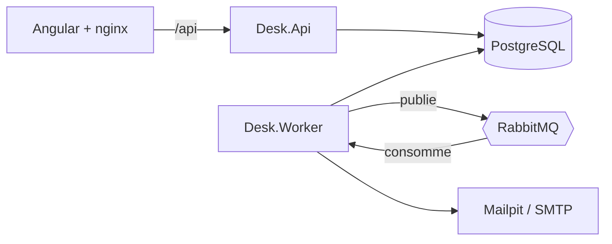

# DeskFlow

Plateforme de ticketing helpdesk multi-entreprises : un utilisateur se connecte avec Google ou GitHub, crée un ticket, un agent le traite, et e-mails, relances SLA et brouillons d'articles partent via RabbitMQ.
Projet portfolio : .NET 10, Angular, RabbitMQ (outbox, retries, DLQ, idempotence), isolation stricte des données par entreprise.

> Statut : phase 0 (fondations). Spécification complète : [docs/SPEC.md](docs/SPEC.md).

## Démarrage en 3 commandes

```bash
cp .env.example .env        # puis remplacer les mots de passe « change-me »
docker compose up --build
curl http://localhost:5148/health/ready
```

| Service | URL |
| --- | --- |
| Application (nginx) | http://localhost:8080 |
| API | http://localhost:5148 (`/health`, `/health/ready`) |
| RabbitMQ (management) | http://localhost:15672 |
| Mailpit | http://localhost:8025 |

## Stack

ASP.NET Core (.NET 10) · EF Core + PostgreSQL · `RabbitMQ.Client` · SignalR · MailKit · Angular (standalone, signals) + Tailwind CSS · Docker Compose · GitHub Actions.

## Architecture



## Développement local

```bash
dotnet test DeskFlow.slnx          # tests .NET (SDK 10)
cd web && npm ci && npm start      # front sur http://localhost:4200
```

## Documentation

- [Cahier des charges](docs/SPEC.md)
- [Décisions d'architecture (ADR)](docs/adr)
- [Journal de troubleshooting](docs/troubleshooting/README.md)
