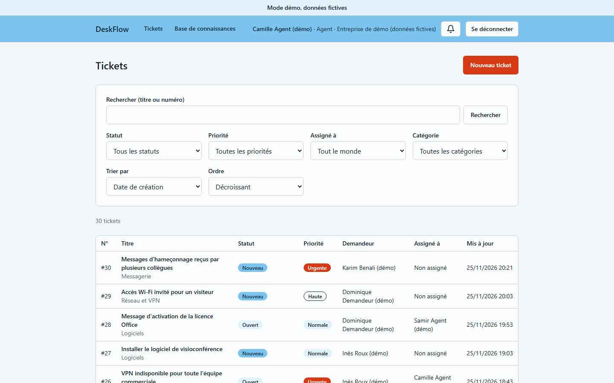
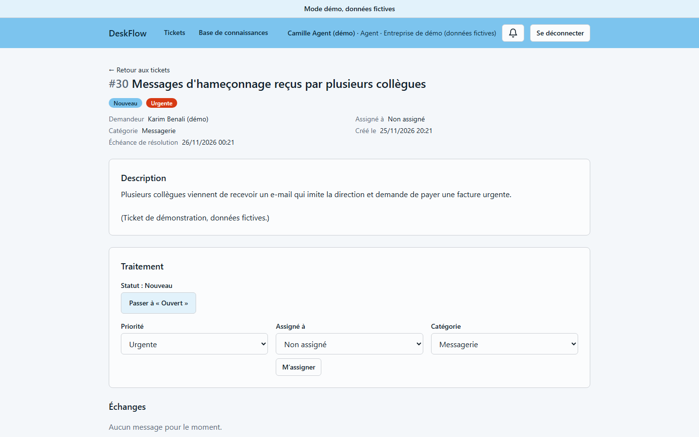
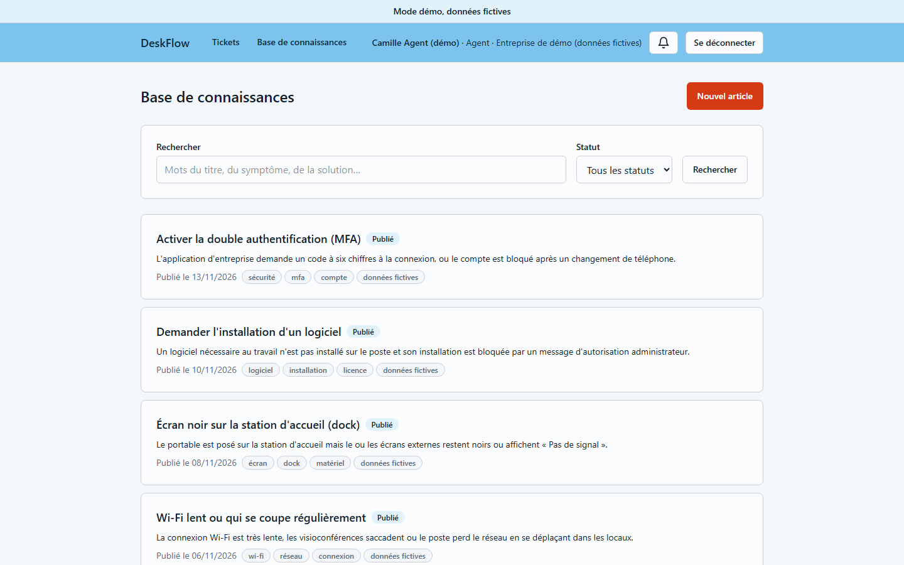
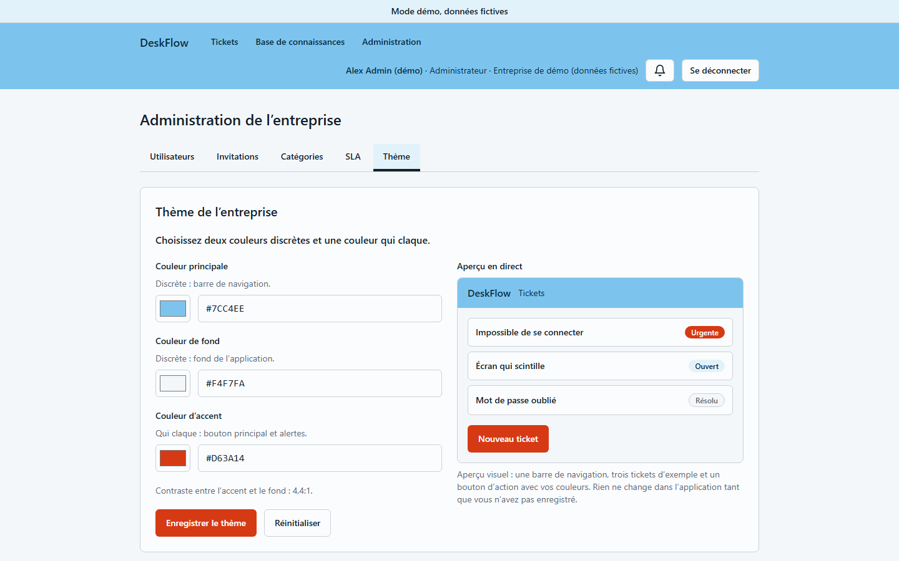
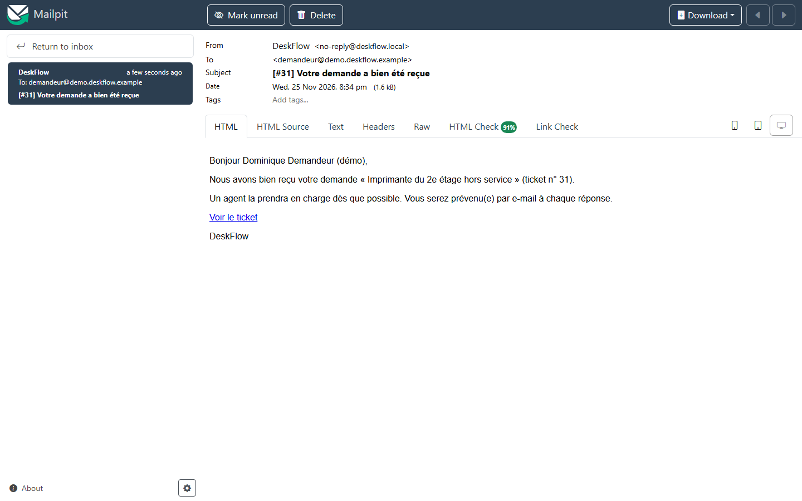
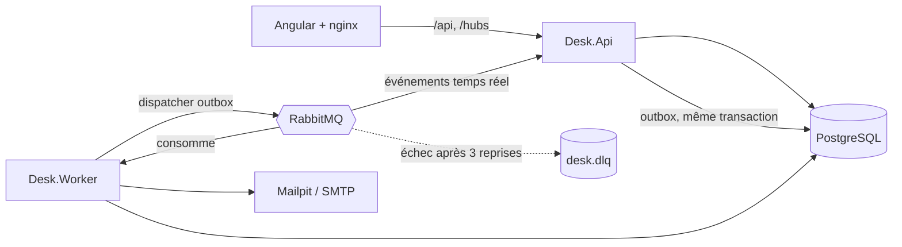

# DeskFlow

Plateforme de ticketing helpdesk **multi-entreprises** : un utilisateur se connecte avec Google ou GitHub, crée un ticket, un agent le traite, et e-mails, relances SLA et brouillons d'articles partent via RabbitMQ.
Projet portfolio : .NET 10, Angular, RabbitMQ (outbox, retries, DLQ, idempotence), isolation stricte des données par entreprise, thème de couleurs par entreprise.

> **Démo en ligne** : pas encore hébergée. Le projet démarre en une commande en local (voir ci-dessous) avec trois comptes de démonstration ; la mise en ligne sur un VPS est préparée dans [docs/deploy.md](docs/deploy.md).
> **Visite guidée de 5 minutes** : [docs/demo.md](docs/demo.md).



| Détail d'un ticket | Base de connaissances |
| --- | --- |
|  |  |
| **Thème de l'entreprise avec aperçu en direct** | **E-mail d'accusé de réception (Mailpit)** |
|  |  |

## Fonctionnalités

- **Multi-entreprises** : une base partagée, un `TenantId` sur chaque ligne, filtres EF Core globaux ; une ressource d'une autre entreprise répond 404. Rôles : demandeur, agent, administrateur d'entreprise, super-administrateur.
- **Connexion** Google et GitHub (invitation obligatoire), JWT court en mémoire + refresh token en cookie `HttpOnly` renouvelé à chaque usage, et un mode démo (trois profils).
- **Tickets** : statuts et priorités avec transitions contrôlées, commentaires publics et notes internes, historique, SLA par priorité, catégories.
- **Asynchrone avec RabbitMQ** : outbox transactionnelle, consommateurs idempotents, reprises à 5 s, 30 s et 2 min, dead-letter queue et commande `replay-dlq`, escalade automatique d'un ticket hors SLA (une seule fois), brouillon d'article à la résolution, notifications en temps réel (SignalR).
- **Base de connaissances** : articles Symptôme / Cause / Solution, publication, recherche insensible à la casse et aux accents, suggestions pendant la saisie d'un ticket.
- **Thème par entreprise** : trois couleurs réglables dans l'administration, aperçu en direct, contraste vérifié, « Réinitialiser » restaure la palette par défaut.

## Démarrage en 3 commandes

```bash
cp .env.example .env        # puis renseigner JWT_KEY (openssl rand -base64 48) et remplacer les « change-me »
docker compose up --build   # attend que tout soit sain ; migrations et données de démo au premier démarrage
# ouvrir http://localhost:8080 puis « Essayer la démo »
```

Le mode démo crée une entreprise fictive avec 12 articles et 30 tickets (aucun e-mail n'est envoyé au démarrage). Les connexions Google et GitHub demandent des identifiants OAuth : voir [docs/setup-oauth.md](docs/setup-oauth.md).

| Service | URL |
| --- | --- |
| Application (nginx) | http://localhost:8080 |
| API | http://localhost:5148 (`/health`, `/health/ready`) |
| RabbitMQ (management) | http://localhost:15672 |
| Mailpit (e-mails) | http://localhost:8025 |

## Stack

ASP.NET Core (.NET 10) · EF Core + PostgreSQL · `RabbitMQ.Client` · SignalR · MailKit · Angular (standalone, signals) + Tailwind CSS · Docker Compose · GitHub Actions · xUnit + Testcontainers · Playwright.

## Architecture



Détails (flux, topologie RabbitMQ, isolation) : [docs/architecture.md](docs/architecture.md).

## Tests et qualité

```bash
dotnet test DeskFlow.slnx -m:1             # unitaires + intégration (Testcontainers : Docker requis)
cd web && npm ci && npm test -- --no-watch # tests Angular
cd web && npm run e2e                      # Playwright contre la pile Docker lancée (compose up)
```

La CI (GitHub Actions) exécute le format et les tests .NET, le lint, Prettier, les tests et le build Angular, le build des images Docker et le parcours E2E sur la pile complète. Chaque pull request a été auditée avant fusion (conformité, sécurité, isolation).

## Documentation

- [Cahier des charges](docs/SPEC.md) · [Architecture](docs/architecture.md) · [Démo de 5 minutes](docs/demo.md)
- [Décisions d'architecture (ADR)](docs/adr)
- [Journal de troubleshooting](docs/troubleshooting/README.md) : les problèmes réellement rencontrés, avec cause et solution
- [Runbook DLQ](docs/runbooks/dlq.md) · [Identifiants OAuth](docs/setup-oauth.md) · [Déploiement](docs/deploy.md)
- Contrat d'API : [docs/api/openapi.json](docs/api/openapi.json)

## Limites connues

- La démo n'est pas encore hébergée ; le flux de déploiement ([docs/deploy.md](docs/deploy.md)) n'a pas été testé sur un vrai serveur.
- Les connexions Google et GitHub n'ont pas été éprouvées de bout en bout avec de vrais identifiants dans ce dépôt ; le mode démo est le parcours testé.
- Tests E2E et audits d'accessibilité automatisés (axe) sur Chromium seulement.
