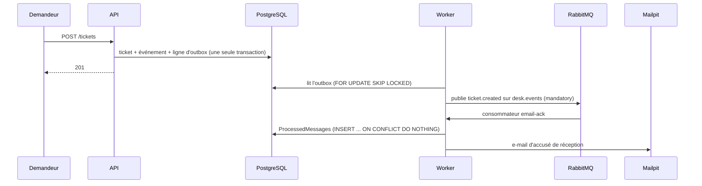

# Architecture

Vue d'ensemble de DeskFlow. Les décisions détaillées sont dans les [ADR](adr), le cahier des charges dans [SPEC.md](SPEC.md).

## Composants

| Composant | Rôle |
| --- | --- |
| `Desk.Api` | API REST (`/api/v1`), authentification, SignalR (`/hubs/notifications`), migrations et données de démo au démarrage |
| `Desk.Worker` | Dispatcher d'outbox, consommateurs RabbitMQ, `SlaWatcher`, commande `replay-dlq` |
| `Desk.Core` | Domaine et règles (transitions de statut, SLA, contraste du thème), sans dépendance d'infrastructure |
| `Desk.Infrastructure` | EF Core, outbox, couche RabbitMQ, consommateurs, e-mail |
| `web` | Angular (standalone, signals), servi par nginx qui joue aussi le rôle de reverse proxy vers l'API |
| PostgreSQL · RabbitMQ · Mailpit | Données · bus d'événements · capture des e-mails en démo |

Monolithe modulaire à deux processus (API et Worker) qui partagent les mêmes projets : [ADR 001](adr/001-modular-monolith.md).

## Flux : création d'un ticket

L'événement n'est publié que si la transaction métier a réussi (outbox), et un message reçu deux fois n'a qu'un effet (table `ProcessedMessages`) : [ADR 008](adr/008-messaging-layer-design.md).

## Topologie RabbitMQ

- Exchanges : `desk.events` (topic), `desk.retry`, `desk.dlx`.
- Une file par consommateur (`desk.email-ack`, `desk.assignment-notifier`, `desk.comment-notifier`, `desk.kb-draft`, `desk.escalation`, plus la file temps réel de l'API).
- Reprises : une file à délai (TTL) par consommateur et par étape, `desk.<consommateur>.retry.5s`, `.30s`, `.2m`. Un message est livré 4 fois au plus (immédiatement, puis après 5 s, 30 s, 2 min), puis part dans `desk.dlq` avec les en-têtes de diagnostic (`x-failed-consumer`, `x-failure-reason`, `x-failure-kind`…).
- Un message illisible (poison) va directement en DLQ.
- Rejouer : [runbook DLQ](runbooks/dlq.md) (`replay-dlq`, `--dry-run`).

## Consommateurs

| Consommateur | Effet |
| --- | --- |
| `EmailAck` | Accusé de réception au demandeur |
| `AssignmentNotifier` | E-mail à l'agent assigné |
| `CommentNotifier` | E-mail pour les commentaires publics (jamais à l'auteur) |
| `KbDraft` | Brouillon d'article à la résolution d'un ticket (un seul par ticket) |
| `Escalation` | Un cran de priorité en plus, une seule fois, pour un ticket hors SLA |
| `SlaWatcher` (tâche, 60 s) | Détecte les dépassements, marqueur unique `SlaBreach` posé dans la transaction d'outbox |
| `AgentRealtimeConsumer` | Pousse les événements aux agents connectés via SignalR ([ADR 009](adr/009-sla-watcher-and-realtime-hub.md)) |

## Isolation multi-entreprise

[ADR 002](adr/002-shared-database-tenant-id.md) : une base, un `TenantId` par ligne métier. Un filtre global EF Core est alimenté par `ITenantContext` (claim `tid` du JWT, ou `TenantId` du message pour le Worker), un intercepteur de `SaveChanges` renseigne et vérifie la colonne, et seuls les endpoints SuperAdmin désactivent le filtre. Une ressource d'une autre entreprise répond 404, jamais 403. Les tests d'intégration d'isolation vérifient chaque ressource avec deux entreprises.

## Authentification

OAuth2 Google et GitHub (accès sur invitation), JWT de 15 minutes gardé en mémoire côté navigateur, refresh token de 7 jours en cookie `HttpOnly`, haché en base et renouvelé à chaque usage ; la réutilisation d'un ancien token révoque toute sa famille. Front et API partagent le même site grâce au reverse proxy (cookie `SameSite=Lax`). Voir SPEC section 5 et [ADR 004](adr/004-access-token-validity-window.md).

## Thème

Trois couleurs par entreprise, stockées côté API et appliquées par variables CSS sur `:root` (`web/src/styles/tokens.css` pour les valeurs par défaut). Les couleurs de texte (`--on-*`) sont calculées côté navigateur pour garder un contraste d'au moins 4,5:1 ; l'aperçu de l'administration est isolé dans une portée dédiée tant que le thème n'est pas enregistré.

## Déploiement

Docker Compose en local ; fichier de production, images GHCR et Caddy (HTTPS) décrits dans [deploy.md](deploy.md).
